# K27 Turbocharger Compressor: Reverse Engineering and CFD

**Reconstruction of a BorgWarner K27 turbocharger compressor from the physical part, and CFD analysis in SolidWorks Flow Simulation and ANSYS CFX.**

> [!NOTE]
> **Status: work in progress.** The SolidWorks Flow Simulation stage is done. The ANSYS CFX stage is underway, and its results will be added after they are verified.

<table>
  <tr>
    <td></td>
    <td></td>
    <td>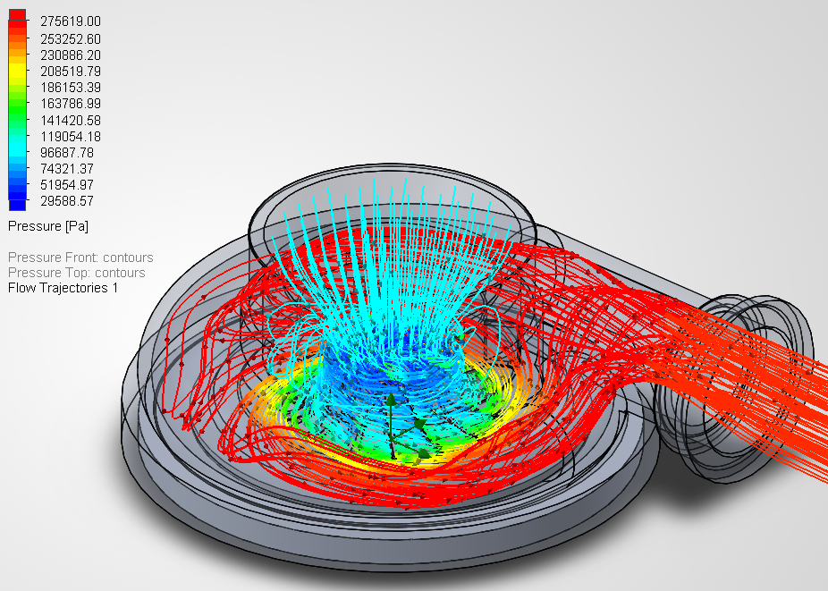</td>
  </tr>
  <tr>
    <td><em>The real K27 compressor housing.</em></td>
    <td><em>Reconstructed CAD (SolidWorks).</em></td>
    <td><em>CFD flow trajectories at about 100,300 rpm (run B2).</em></td>
  </tr>
</table>

---

## Overview

This repository documents my CFD study of the compressor of a BorgWarner K27 turbocharger. No manufacturer CAD or drawings were available, so I measured the physical turbocharger and rebuilt the geometry in SolidWorks. I then simulated the compressor to study its internal flow and to build a preliminary compressor map.

<!-- CONFIRM: add one line on the academic context only if you want it public (e.g. developed at UPQ as an individual project, with advisor names if they agree) -->

I did not start on the K27. I first debugged the rotating-flow setup on a generic practice model, then moved to the K27 geometry. SolidWorks Flow Simulation can't combine its high-Mach option with rotation, so the high-speed work is moving to ANSYS.

<!-- CONFIRM: check this limitation against the Flow Simulation help for your version (2026) before publishing; it appears again in the ANSYS section -->

**What this repository shows**
- Reverse engineering: measuring a real turbocharger and rebuilding its flow geometry in CAD
- A rotating-machinery CFD setup (rotating region, boundary conditions, mesh, goals) developed step by step
- Independent checks beyond solver convergence: mass balance, shaft power vs. fluid enthalpy gain, tip speed, derived efficiency
- A preliminary compressor map, with its limitations stated

### Summary of results so far

| Item | Result |
|---|---|
| Geometry | Compressor housing and impeller rebuilt from measurements: 14 blades (7 + 7 splitters), 78.5 mm exit diameter |
| Run B1 (about 33,400 rpm) | All goals converged. Mass flow balances within 0.2%, and shaft power matches fluid enthalpy gain within about 1% |
| Run B2 (about 100,300 rpm) | Preliminary, not fully converged. Blade tip speed is about 1.2 times the ambient speed of sound |
| Compressor map | Preliminary map from a parametric sweep, forward flow only |
| ANSYS CFX | Model setup and meshing underway |

<!-- CONFIRM: the 48-point map in the compressor map section; check the point count and speed range against the final sweep -->

## My role

This is an individual project. My work included:

- Measuring the physical K27 and rebuilding the compressor and turbine geometry in SolidWorks
- Preparing the CAD for CFD (separating the impeller, sealing the flow volume, building the rotating region)
- Setting up, running and checking the simulations
- Building the compressor map from a parametric sweep
- Setting up the ANSYS CFX model: splitting the fluid volume into bodies and meshing it

<!-- CONFIRM: adjust this list so it matches exactly what you did -->

## Tools and methods

| Area | Tools / methods |
|---|---|
| CAD | SolidWorks 2026: parts, assemblies, reconstruction from physical measurements |
| CFD (stage 1) | SolidWorks Flow Simulation 2026: steady-state, air, rotating region |
| CFD (stage 2) | ANSYS 2026 R1 Student: Workbench, Meshing, CFX, CFD-Post |
| Post-processing | Excel (compressor map and data table) |

---

## From physical part to CAD

<table>
  <tr>
    <td>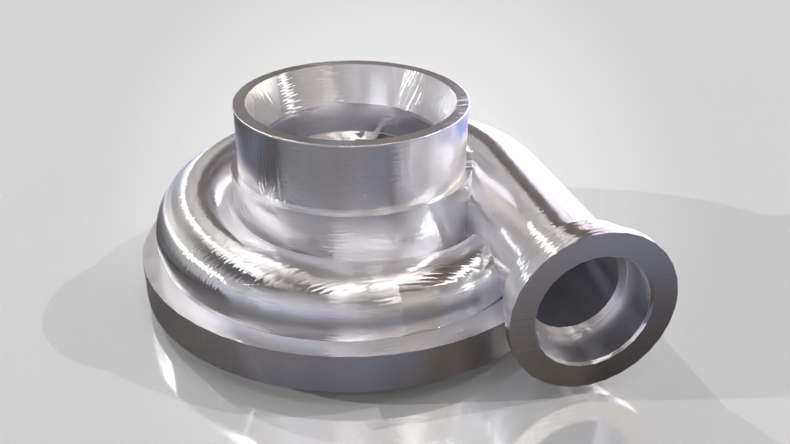</td>
    <td>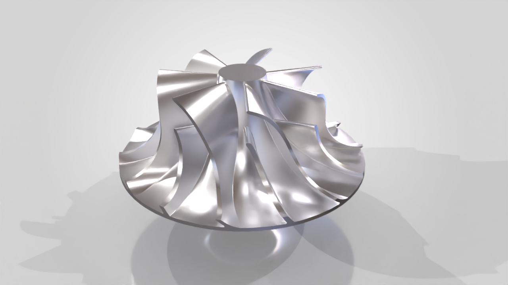</td>
  </tr>
  <tr>
    <td><em>Reconstructed compressor housing.</em></td>
    <td><em>Reconstructed compressor impeller.</em></td>
  </tr>
</table>

<!-- OPTIONAL: real impeller photo next to the CAD impeller, uncomment if you have the photo

*The real impeller, used to count blades and compare the CAD profile.*
-->

> [!NOTE]
> This is a preliminary design. The blade profile was estimated by comparing the CAD geometry with the real impeller. It was not scanned or measured point by point.

| Dimension | Value | Source |
|---|---|---|
| Impeller exit diameter | about 78.5 mm | Measured |
| Inducer tip diameter | about 52 mm | Measured |
| Impeller blades | 7 main + 7 splitters (14 total) | Counted on the real impeller |
| Tip clearance | about 0.5 mm | Measured |
| Housing inlet diameter | about 93 mm | Measured |
| Housing outlet diameter | about 50 mm | Measured |
| Inlet recirculation slot (annular) | about 2.5 mm wide | From the CAD |
| Diffuser | Vaneless | Observed |
| Blade profile | Estimated | Compared against the real impeller |

<!-- CONFIRM: that each "Measured" label is accurate (including the three rows added in this version); change to "Estimated" for anything you could not measure directly -->

The center housing (bearings, lubrication passages) was not reconstructed, since it does not affect the gas path. The turbine side was modeled for geometry only and has not been simulated.


*Exploded view of the reconstructed K27.*

The STEP files are in [`models/`](models/): the full assembly and the impeller separately.

---

## CFD setup (SolidWorks Flow Simulation)

<table>
  <tr>
    <td>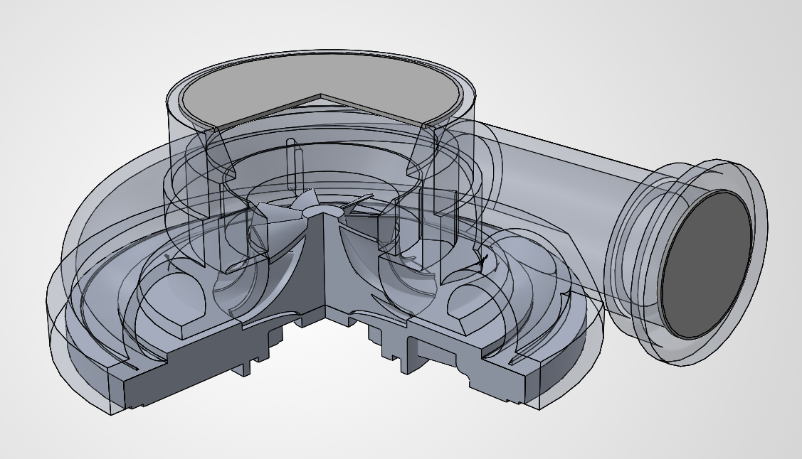</td>
    <td>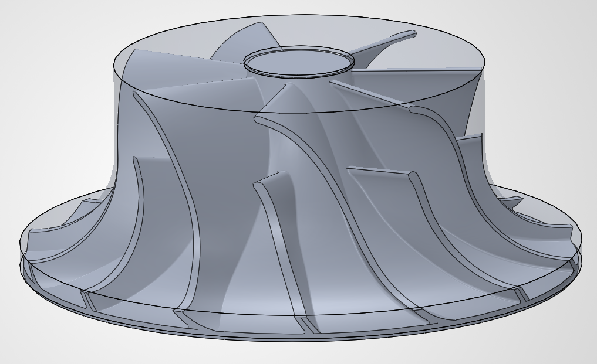</td>
  </tr>
  <tr>
    <td><em>Compressor prepared for CFD: lids added, flow volume sealed.</em></td>
    <td><em>Auxiliary rotating region around the impeller.</em></td>
  </tr>
</table>

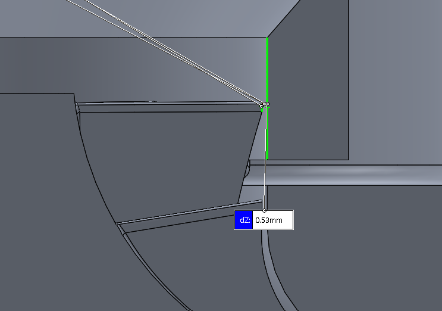
*Detail of the impeller-to-casing clearance (about 0.5 mm).*

| Item | Setting |
|---|---|
| Analysis | Steady-state, air |
| Rotation | Rotating region around the impeller, axis along Y |
| Boundary conditions | Environment pressure at inlet and outlet (free delivery: the outlet discharges to ambient pressure) |
| Mesh | About 641,000 cells, about 309,000 in contact with solids |
| Goals | Impeller torque, bulk total pressure and total temperature (inlet and outlet), mass flow (inlet and outlet) |

<!-- CONFIRM: the mesh and goals above describe run B1; check them against the settings you used for B2 -->

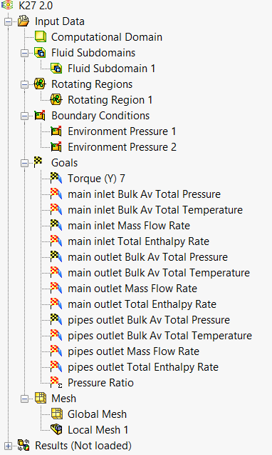
*Analysis tree with the boundary conditions, rotating region and goals.*

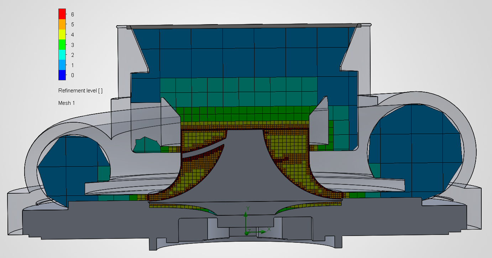
*Mesh on a cut plane through the impeller, with the clearance region in view.*

---

## Results

Two runs on the reconstructed K27, both at free delivery.

| Run | Speed | Notes |
|---|---|---|
| B1 | 3,500 rad/s (about 33,400 rpm) | Started from scratch, 1,000 iterations, all goals converged |
| B2 | 10,500 rad/s (about 100,300 rpm) | Restarted from B1, 670 iterations, not fully converged |

### Run B1

<table>
  <tr>
    <td>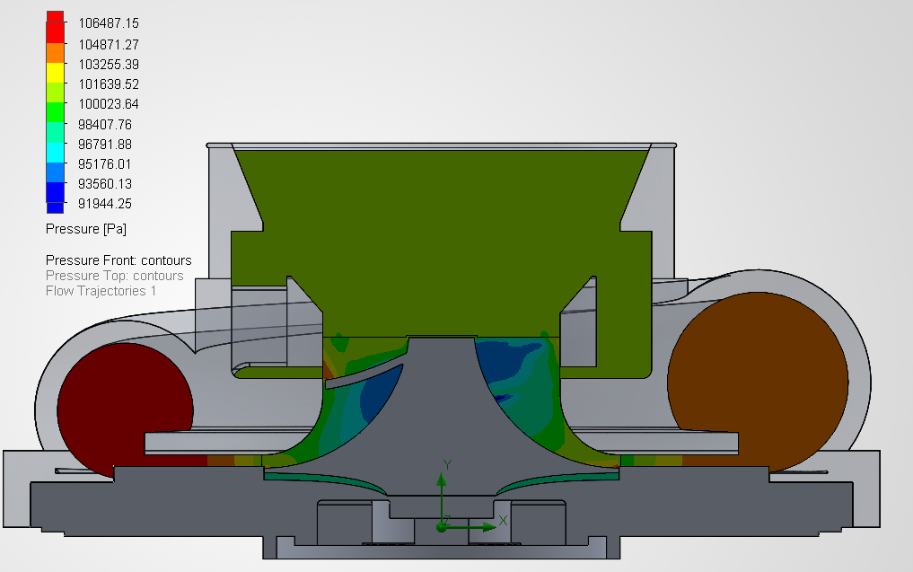</td>
    <td>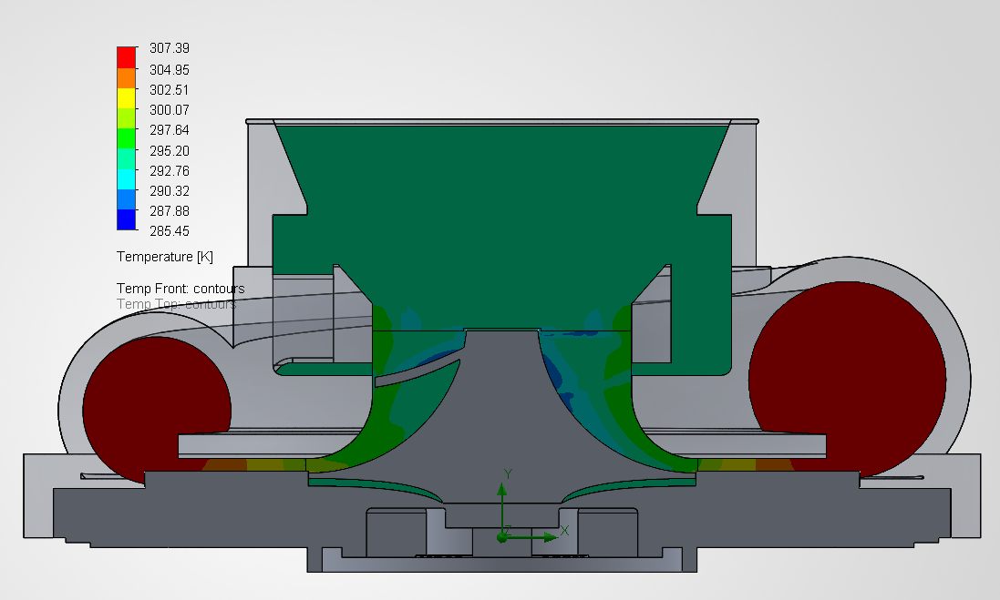</td>
  </tr>
  <tr>
    <td><em>Pressure. Total pressure rises through the impeller and volute, with a local low-pressure zone near the inducer (about 93 to 96 kPa).</em></td>
    <td><em>Total temperature, about 285 to 307 K, highest in the volute.</em></td>
  </tr>
  <tr>
    <td>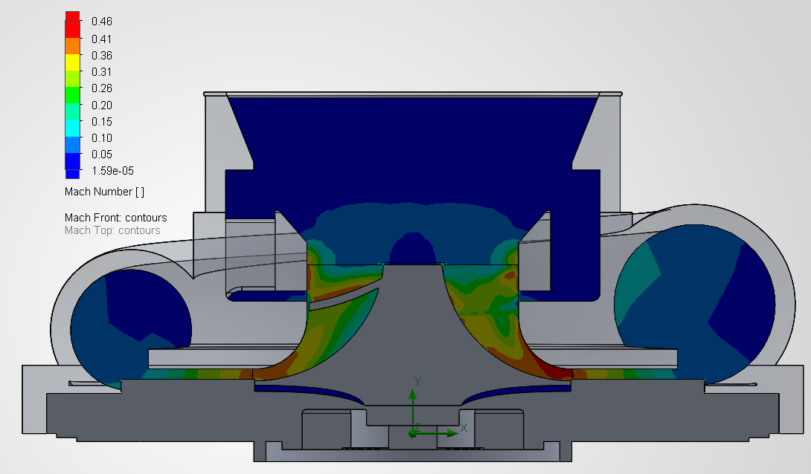</td>
    <td>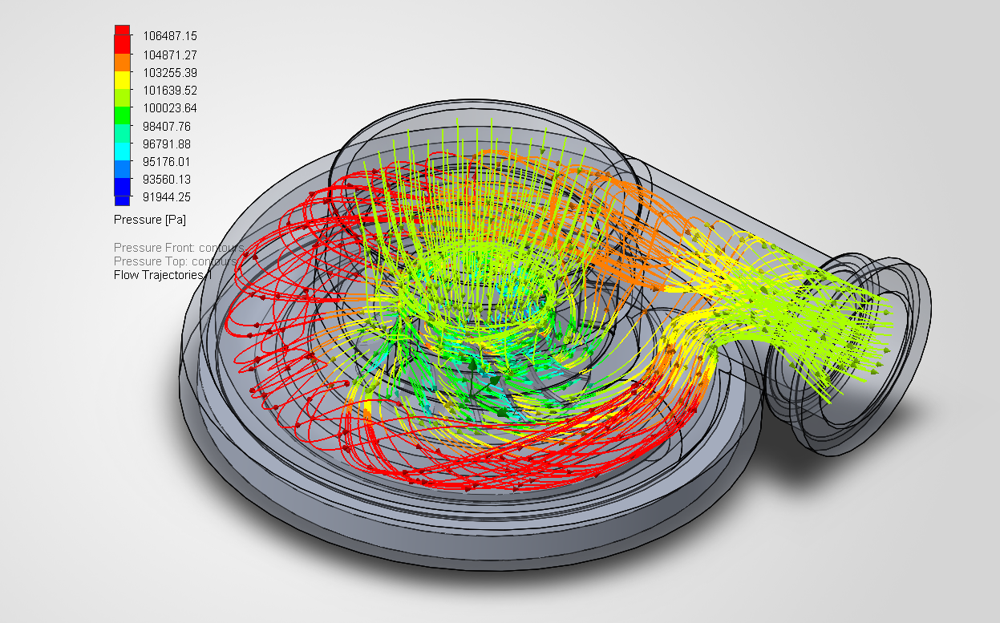</td>
  </tr>
  <tr>
    <td><em>Mach number. Maximum of about 0.46, near the impeller exit.</em></td>
    <td><em>Flow trajectories. Strong swirl in the volute before the outlet passage.</em></td>
  </tr>
</table>

### Run B2

<table>
  <tr>
    <td>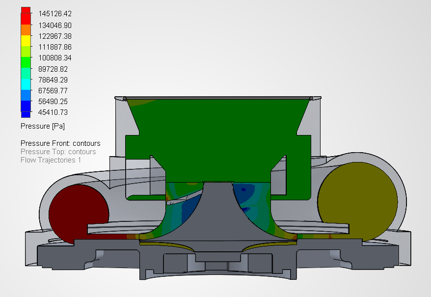</td>
    <td>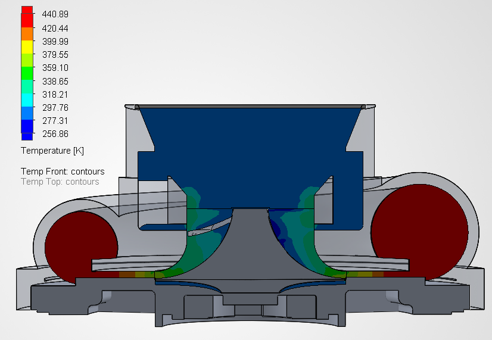</td>
  </tr>
  <tr>
    <td><em>Pressure.</em></td>
    <td><em>Total temperature. 441 to 449 K in the volute.</em></td>
  </tr>
  <tr>
    <td>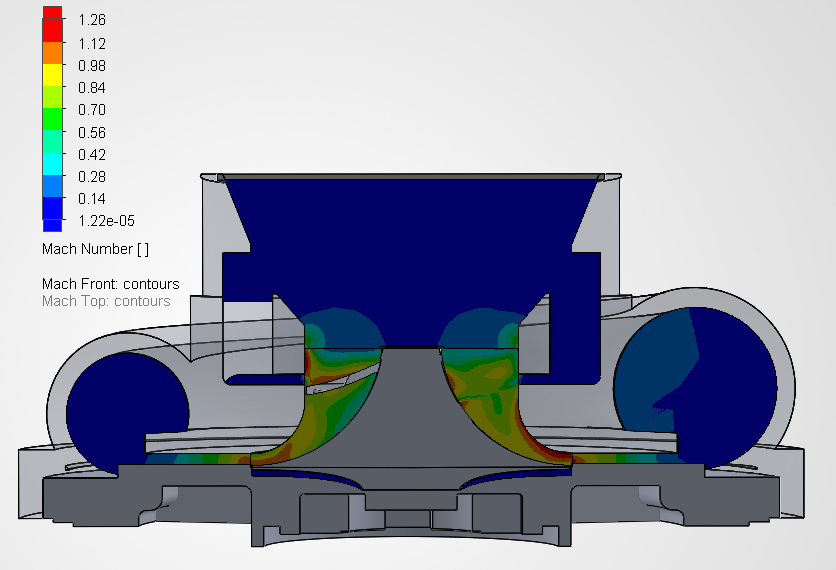</td>
    <td></td>
  </tr>
  <tr>
    <td><em>Mach number.</em></td>
    <td><em>Flow trajectories.</em></td>
  </tr>
</table>

### Goal convergence

<table>
  <tr>
    <td>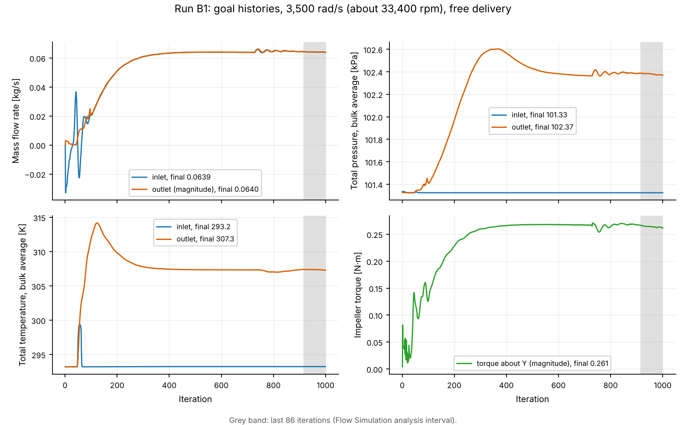</td>
    <td>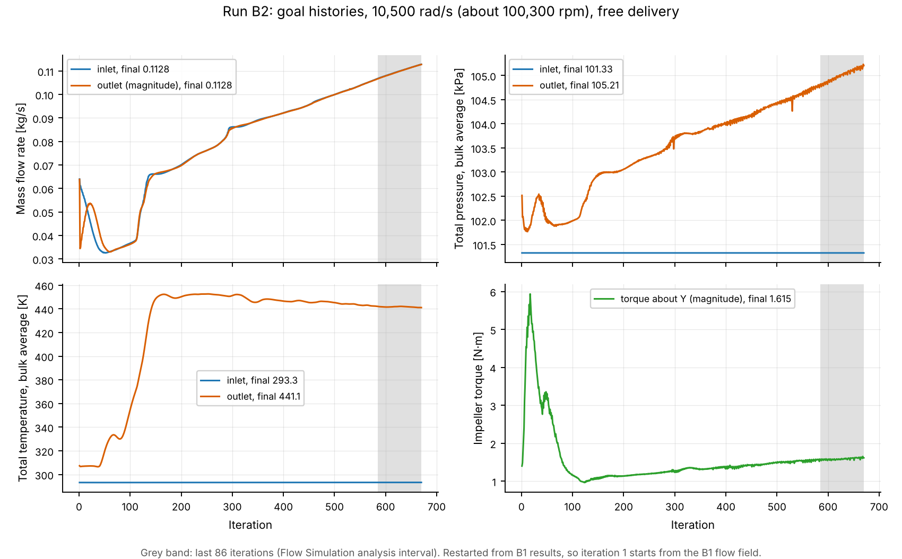</td>
  </tr>
  <tr>
    <td><em>B1: goals settle and are reported as achieved.</em></td>
    <td><em>B2: mass flow, inlet temperature and pressure ratio had not fully settled when the run was stopped.</em></td>
  </tr>
</table>

---

## Checks

Goal convergence alone is not enough. In the practice model, a run with no active rotating region converged completely and produced almost no pressure rise. So every run is also checked against independent quantities.

| Check | Run B1 | Run B2 |
|---|---|---|
| Inlet vs. outlet mass flow | 0.0639 vs. 0.0640 kg/s (0.2%) | 0.1099 vs. 0.1098 kg/s (interval averages) |
| Shaft power (torque x speed) vs. fluid enthalpy gain | 913 W vs. 904 W | 16.96 kW vs. 16.84 kW |
| Blade tip speed | about 137 m/s | about 412 m/s (about 1.2x ambient speed of sound) |
| Total pressure ratio | 1.010 | about 1.04 |
| Total temperature rise | 14.1 K | about 148 K |
| Isentropic efficiency (derived) | about 6% | about 2% |

<!-- CONFIRM: for B2, the 16.84 kW enthalpy figure only works out with a mass flow of about 0.113 kg/s, but the mass-balance row above uses 0.1099 kg/s (interval averages). Use the same basis in both rows before publishing. -->

The derived efficiency is T01 x (PR^((gamma-1)/gamma) - 1) / (total temperature rise), with gamma = 1.4 and T01 the inlet total temperature.

**What each check tells me**
- **Mass balance** shows the solution conserves mass between inlet and outlet.
- **Shaft power vs. enthalpy gain** shows the work the impeller does is the energy the air gains. It confirms the energy balance, but it does not by itself prove the pressure rise is correct.
- **Tip speed** shows why the high-speed run needs a compressible treatment (see the ANSYS stage). It does not give the local Mach number, only the order of magnitude.
- **Efficiency** is low because both runs discharge to ambient pressure. With almost no back pressure, nearly all the work ends up as heat. This is why a back-pressure sweep is needed to get a real compressor map.

---

## Compressor map (SolidWorks Flow Simulation)

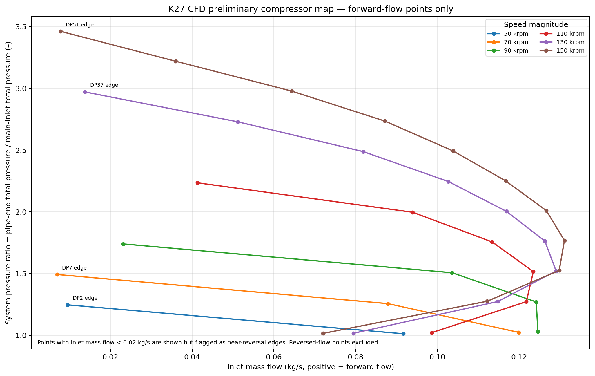
*Preliminary compressor map from the parametric sweep. Forward-flow points only.*

| Item | Setting |
|---|---|
| Method | Parametric sweep at constant speed, varying the static pressure at the end of the outlet pipe |
| Design points | 48 |
| Speed range | 50,000 to 150,000 rpm |
| Domain | Full 360 degree wheel, ambient inlet, 150 mm long, 50 mm diameter outlet pipe added |
| Mesh | About 400,000 cells, about 100,000 in contact with solids |

<!-- CONFIRM: sweep details (points, speeds, mesh) come from your earlier notes; check them against the final runs -->

The data behind the plot is in [`data/compressor_map_sw.csv`](data/compressor_map_sw.csv).

**Reference.** No official K27 map exists, so I compare against a third-party approximate map (peak efficiency about 77%). It is an approximation, not validation data.

<!-- ADD when ready: overlay of my map vs. the reference as images/results/res_12_map_vs_reference.png, with the source credited and linked (do not re-host their image) -->
<!-- ADD when ready: 2 to 3 lines on how my map compares (pressure ratio, flow range, efficiency) -->

---

## ANSYS stage (in progress)

SolidWorks Flow Simulation does not allow the high-Mach-number option together with rotation. At 10,500 rad/s the blade tip speed is about 1.2 times the speed of sound, so the relative flow can be transonic and the setup cannot treat it properly. This stage moves the same geometry to ANSYS for compressible flow in rotating regions.

<table>
  <tr>
    <td></td>
    <td></td>
  </tr>
  <tr>
    <td><em>Internal fluid volume split into three bodies: inlet, impeller (kept at 360 degrees) and volute.</em></td>
    <td><em>Mesh overview, with the impeller region refined.</em></td>
  </tr>
</table>

| Item | Status |
|---|---|
| Software | ANSYS 2026 R1 Student: Workbench, Meshing, CFX, CFD-Post |
| Geometry | Fluid volume imported from SolidWorks and split into inlet, impeller and volute bodies |
| Mesh | Two meshes tried so far (below) |
| Impeller-to-volute interface | Under review. In the real geometry the impeller exit sits against the housing base plate, so there is no fluid face joining the impeller exit to the volute |
| First runs | CFX-1 and CFX-2 at 20,000 rpm with the outlet at 102 kPa. Results are being checked and are not published yet |

| Mesh | Cells | Quality notes |
|---|---|---|
| v1 | 276,654 | Skewness average 0.27, maximum 0.98. Orthogonal quality average 0.73, minimum 0.016 |
| v2 (1 mm face sizing on the annulus) | 445,098 | Worst cells (skewness about 0.99) mostly at the impeller hub, a few at the shroud |

<!-- CONFIRM: which mesh each CFX run used (the second run used a refined mesh) and whether v1 and v2 are the final meshes you want to describe -->

An inflation layer on the impeller volume was tried and did not improve the mesh quality, so it was not kept.

**Next steps**
- [ ] Resolve the impeller-to-volute interface
- [ ] Verify the monitors and convergence of the first CFX runs, then publish the results
- [ ] Re-run the high-speed point with a converged solution
- [ ] Mesh independence study
- [ ] Rebuild the impeller blade profile (BladeGen / Vista CCD) and compare it against the SolidWorks wheel
- [ ] Compare the map against the reference

---

<details>
<summary><strong>Practice model: what went wrong and what I learned</strong></summary>

<br>

Before the K27, I used a generic turbocharger CAD from GrabCAD (impeller about 60 mm, no manufacturer reference) to debug the setup.

<table>
  <tr>
    <td>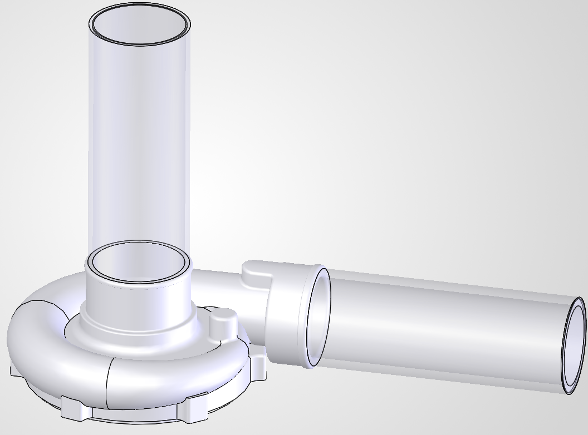</td>
    <td>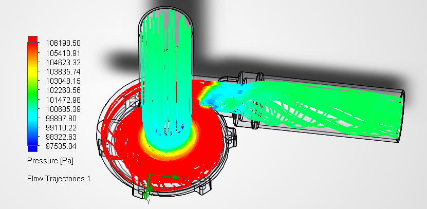</td>
  </tr>
  <tr>
    <td><em>Domain with inlet and outlet pipes.</em></td>
    <td><em>Pressure loss before the outlet.</em></td>
  </tr>
</table>

| Problem | What I found |
|---|---|
| Real Wall rotation at 1,000 rad/s | Goals reported 100% converged, but pressures and temperatures were not physical. An outlet flow of 0.5 m³/s was also a wrong input. |
| First rotating region | Some blade tips were outside the rotating domain. Warnings for supersonic flow and instability. |
| 4.5 million cell mesh | Still unstable. Stopped at 141 iterations. More cells did not fix it. |
| Open boundaries close to the housing | Backflow and vortices crossing the openings. Added inlet and outlet pipes. |
| Speed ramp (1,000, 3,000, 5,000 rad/s) | Average inlet mass flow rose from about 0.008 to 0.0219 to 0.0378 kg/s, but goals kept oscillating. Treated as preliminary. |

<!-- CONFIRM: the 4.5 million cell count and the 141 iterations belong to the same run, and the 0.0378 kg/s is the same kind of average as the other two values; check against the solver logs -->

**Lessons**
- The rotating region has to fully contain the impeller and connect cleanly to the stationary domain.
- Small clearances need care in both the geometry and the mesh.
- Mesh refinement cannot fix a bad geometry or an incompatible boundary condition.
- Convergence has to be checked together with mass conservation and physical plausibility.

</details>

---

## Assumptions and limitations

- **Estimated blade profile.** The impeller blades were estimated by comparison with the real part, so expect some deviation from the real compressor.
- **No physical validation.** There is no test bench data. Results are judged by internal consistency and by comparison with a third-party approximate map.
- **Exact variant unknown.** There are no official K27 specifications, so the geometry comes from my own measurements.
- **Steady state only.** No impeller and volute unsteady interaction.
- **Compressor only.** The turbine, bearings and engine are not simulated. Speed is imposed, not obtained from a power balance with the turbine.
- **Run B2 not fully converged.** Inlet temperature, mass flow, inlet enthalpy rate and pressure ratio had not fully settled, so B2 is a preliminary high-speed point.
- **Software limit.** High-Mach treatment and rotation can't be combined in Flow Simulation, which is why the study continues in ANSYS.
- **ANSYS interface and mesh.** The impeller-to-volute interface and the mesh quality at the impeller hub and shroud are still being worked on, so no ANSYS results are published yet.

---

## Repository structure

```
├── README.md
├── models/     K27 assembly and impeller (STEP)
├── data/       Compressor map data (CSV)
└── images/
    ├── hardware/   Photos of the real K27
    ├── cad/        CAD views
    ├── setup/      SolidWorks Flow Simulation setup and mesh
    ├── results/    Contours, trajectories, convergence and compressor map
    ├── ansys/      ANSYS fluid bodies and mesh
    └── practice/   Practice model (collapsed section)
```

---

**Ian Delgadillo** · Automotive Technology Engineering student, Universidad Politécnica de Querétaro (UPQ) · Querétaro, México
